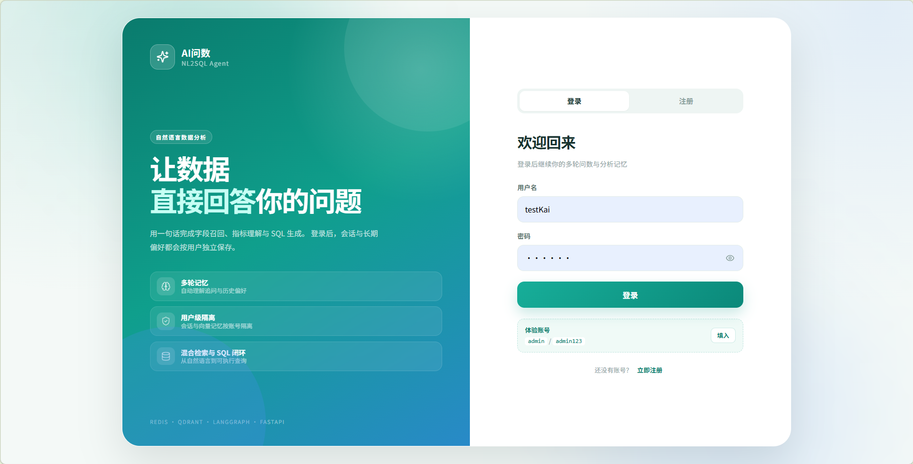
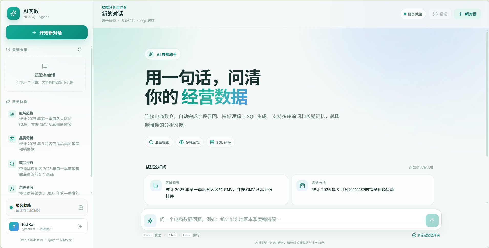
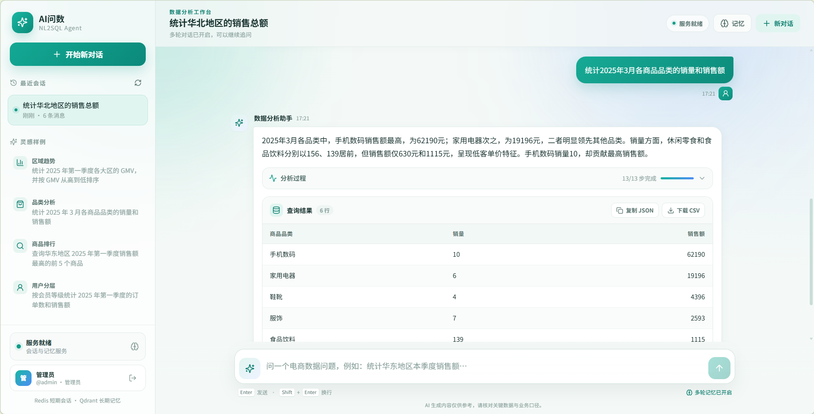
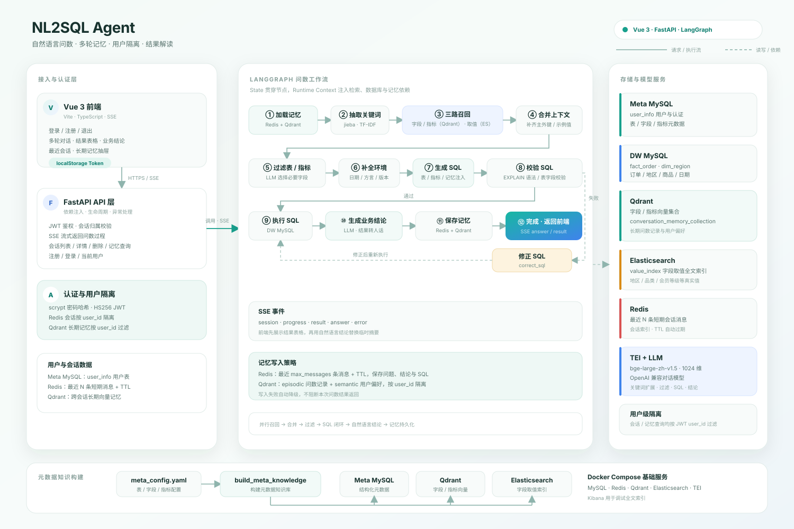

<div align="center">

<h1>「AI问数」NL2SQL Agent</h1>

<p><em>基于 LangGraph 的自然语言问数系统：混合检索 · 多轮记忆 · 用户隔离 · SQL 执行与业务结论</em></p>

</div>

<div align="center">


</div>

## 🖼️ 系统截图

<p align="center">
  
  
</p>
<p align="center"><em>登录与注册 · 多轮问数首页</em></p>

<p align="center">
  
</p>
<p align="center"><em>执行过程、查询结果表格与自然语言分析结论</em></p>

## 📖 项目简介

`NL2SQL Agent` 是一个可直接运行的AI问数系统。用户登录后，用自然语言提出问题，系统会先加载多轮会话和长期记忆，再围绕问题完成字段、指标和字段取值的混合检索，随后通过 LangGraph 编排 SQL 生成、校验、修正与执行，最后把结构化结果转换成业务用户能直接看懂的自然语言结论，并通过 SSE 实时返回前端。

它不是一个“把问题直接丢给大模型生成 SQL”的示例，而是一条完整的工程链路：

- **元数据知识库**：表、字段、指标和真实取值分别进入 MySQL、Qdrant 与 Elasticsearch
- **混合检索**：Qdrant 负责字段/指标语义召回，Elasticsearch 负责取值全文检索
- **多轮记忆**：Redis 保存短期消息，Qdrant 保存跨会话的长期向量记忆
- **用户体系**：JWT 登录、scrypt 密码哈希、会话与记忆按用户隔离
- **结果解读**：SQL 执行后生成自然语言业务结论，并同步写入会话记忆
- **流式交互**：Vue 3 前端通过 SSE 展示节点进度、查询结果和最终回答

## ✨ 核心能力

- **混合检索而非模型直出**
  - 先召回相关字段、指标和值域，再组织上下文生成 SQL，降低选错表、选错字段和理解错指标的概率。
- **完整的 SQL 闭环**
  - 包含 SQL 生成、`EXPLAIN` 校验、失败修正和最终执行。
- **自然语言结果解读**
  - `generate_answer` 节点结合用户问题、指标口径和查询结果生成业务结论，不再只返回一张表。
- **多轮问数与会话管理**
  - 自动把“那上个月呢”“再按品类拆一下”等追问改写为独立问题。
  - 支持最近会话、会话详情、删除会话和记忆查看。
- **短期 + 长期记忆**
  - Redis 保存最近 N 条消息并设置 TTL；Qdrant 保存问数记录和抽取出的用户偏好。
- **登录与数据隔离**
  - 注册、登录、退出、当前用户查询；会话和长期记忆都按登录用户 id 隔离。
- **清爽的 Vue 前端**
  - 登录页、问数首页、执行过程、结果表格、自然语言结论、会话列表和记忆抽屉。
- **工程化后端结构**
  - `FastAPI + LangGraph + Repository + Service + Client Manager`，配置、日志、依赖注入和生命周期管理清晰。

## 🏗️ 系统架构



系统分为四层：

| 层级 | 主要职责 |
| --- | --- |
| 接入与认证层 | Vue 3 前端、FastAPI API、JWT 鉴权、SSE 流式返回、会话接口 |
| Agent 编排层 | LangGraph 状态图、多路召回、上下文合并、SQL 闭环、结论生成、记忆持久化 |
| 存储与模型层 | Meta MySQL、DW MySQL、Qdrant、Elasticsearch、Redis、TEI Embedding、LLM |
| 元数据构建层 | 从 `meta_config.yaml` 构建表/字段/指标/取值索引 |

### Agent 工作流

```text
load_memory
  → extract_keywords
  → recall_column / recall_value / recall_metric（并行）
  → merge_retrieved_info
  → filter_table / filter_metric
  → add_extra_context
  → generate_sql
  → validate_sql
       ├─ 校验失败 → correct_sql → run_sql
       └─ 校验通过 → run_sql
  → generate_answer
  → persist_memory
  → END
```

关键节点说明：

- `load_memory`：读取 Redis 短期消息和 Qdrant 长期记忆，完成指代改写
- `recall_*`：字段和指标走向量检索，字段取值走全文检索
- `merge_retrieved_info`：补齐主外键、字段示例值和表结构上下文
- `generate_answer`：把 SQL 结果转成自然语言业务结论
- `persist_memory`：把问题、结论、SQL 和偏好写回 Redis / Qdrant

## 🛠️ 技术栈

| 模块 | 技术 | 作用 |
| --- | --- | --- |
| 前端 | Vue 3 / Vite / TypeScript | 登录、问数、会话管理、执行过程和结果展示 |
| 后端 | FastAPI | 认证、问数、会话接口、依赖注入和 SSE |
| Agent 编排 | LangGraph / LangChain | 多阶段问数工作流和模型调用 |
| 关系数据库 | MySQL / SQLAlchemy | 元数据、用户信息和教学数仓 |
| 向量检索 | Qdrant | 字段、指标和长期记忆向量 |
| 全文检索 | Elasticsearch | 字段真实取值索引 |
| 短期记忆 | Redis | 最近 N 条会话消息、会话索引和 TTL |
| Embedding | TEI / `BAAI/bge-large-zh-v1.5` | 中文文本向量化 |
| 登录认证 | PyJWT / scrypt | JWT、密码哈希和用户隔离 |
| 流式协议 | SSE | 节点进度、结果、业务结论和错误消息 |
| 日志追踪 | loguru / ContextVar | request_id 链路日志 |
| 基础设施 | Docker Compose | MySQL、Redis、Qdrant、Elasticsearch、TEI |
| 依赖管理 | pip / npm | Python 与前端依赖 |

## 📁 项目结构

```text
NL2SQL/
├── app/
│   ├── agent/            # LangGraph 图、State、Runtime Context 和节点
│   ├── api/              # FastAPI 路由、依赖注入、生命周期和 Schema
│   ├── clients/          # MySQL / Redis / Qdrant / ES / Embedding 客户端管理
│   ├── conf/             # 配置 dataclass 与加载逻辑
│   ├── core/             # 日志、request_id、JWT 与密码安全
│   ├── entities/         # 业务实体
│   ├── models/           # SQLAlchemy ORM 模型
│   ├── prompt/           # Prompt 加载工具
│   ├── repositories/     # MySQL / Qdrant / Elasticsearch / Redis 仓储
│   ├── scripts/          # 元数据知识库构建脚本
│   └── services/         # 认证、问数、会话与记忆服务
├── conf/                 # app_config.yaml / meta_config.yaml
├── docker/               # Docker Compose、MySQL 初始化、ES、Embedding 挂载
├── docs/images/          # 架构图与系统截图
├── frontend/             # Vue 3 + Vite + TypeScript 前端
├── prompts/              # 问数链路 Prompt
├── main.py               # FastAPI 入口
├── pyproject.toml        # 项目元数据与工具配置
├── requirements.txt      # 后端运行时依赖
└── requirements-dev.txt  # 开发与代码检查依赖
```

## 🚀 快速开始

### 1. 环境要求

- Python `>= 3.14`（建议使用 conda 或 venv 虚拟环境）
- `pip`
- Docker 与 Docker Compose
- Node.js 与 `npm`

### 2. 获取代码

```bash
git clone https://github.com/inokcf/NL2SQL.git
cd NL2SQL
```

### 3. 安装后端依赖

在已激活的 Python 环境中执行：

```bash
python -m pip install -r requirements.txt
```

如需运行代码检查或 pre-commit，再安装开发依赖：

```bash
python -m pip install -r requirements-dev.txt
```

### 4. 配置环境变量

```bash
cp .env.example .env
```

编辑 `.env`：

```bash
# 大模型 API Key
LLM_API_KEY=your_real_api_key

# JWT 签名密钥，生产环境请使用至少 32 字节的随机字符串
AUTH_SECRET_KEY=change-me-to-a-random-string-at-least-32-bytes
```

默认模型配置使用兼容 OpenAI 协议的 DeepSeek：

```yaml
llm:
  model_name: deepseek-v4-flash
  api_key: ${oc.env:LLM_API_KEY}
  base_url: https://api.deepseek.com
```

如需切换其他模型平台，修改 [conf/app_config.yaml](conf/app_config.yaml) 中的 `model_name` 和 `base_url`。

### 5. 准备 Embedding 模型

项目通过 TEI 加载 `BAAI/bge-large-zh-v1.5`。`huggingface-hub` 已包含在 `requirements.txt` 中，安装完依赖后执行：

```bash
hf download BAAI/bge-large-zh-v1.5 \
  --local-dir docker/embedding/bge-large-zh-v1.5
```

### 6. 启动基础服务

```bash
docker compose -f docker/docker-compose.yaml up -d
```

默认端口：

| 服务 | 地址 |
| --- | --- |
| MySQL | `localhost:3307` |
| Redis | `localhost:6380` |
| Qdrant HTTP | `http://localhost:6335` |
| Elasticsearch | `http://localhost:9201` |
| Kibana | `http://localhost:5601` |
| Embedding (TEI) | `http://localhost:8082` |

> MySQL 首次启动会自动执行 `docker/mysql/meta.sql` 和 `dw.sql`。
> 已有数据库无需重建，后端启动时会自动补建 `user_info` 用户表。

### 7. 构建元数据知识库

```bash
python -m app.scripts.build_meta_knowledge -c conf/meta_config.yaml
```

该步骤会：

- 把表、字段、指标写入 Meta MySQL
- 把字段和指标向量写入 Qdrant
- 把字段真实取值写入 Elasticsearch

### 8. 启动后端

```bash
python -m uvicorn main:app --host 0.0.0.0 --port 8000 --reload
```

首次启动会自动创建体验账号（用户表为空时）：

- 用户名：`admin`
- 密码：`admin123`

### 9. 启动前端

```bash
cd frontend
npm install
npm run dev
```

访问 `http://127.0.0.1:5173`，使用体验账号登录，或注册新账号。

前端默认把 `/api` 代理到 `http://127.0.0.1:8000`。如需修改：

```bash
cd frontend
cp .env.example .env
```

```bash
VITE_DEV_PROXY_TARGET=http://127.0.0.1:8000
```

## ⚙️ 配置说明

主要配置位于 [conf/app_config.yaml](conf/app_config.yaml)：

| 配置段 | 说明 |
| --- | --- |
| `llm` | 模型名称、API Key 和 Base URL |
| `auth` | JWT 密钥、签名算法和 Token 有效期 |
| `redis` | 会话 TTL、每个会话保留的消息数 |
| `memory` | 长期记忆开关、召回条数、相似度阈值和抽取开关 |
| `db_meta` / `db_dw` | 元数据库和教学数仓连接 |
| `qdrant` | 向量服务地址和维度 |
| `es` | 全文检索地址和索引名 |
| `embedding` | TEI 地址和模型名称 |

关键默认值：

```yaml
auth:
  token_expire_minutes: 10080   # 7 天

redis:
  session_ttl_seconds: 604800   # 7 天
  max_messages: 20              # 每个会话保留最近 20 条消息

memory:
  long_term_top_k: 5
  long_term_score_threshold: 0.55
  extraction_enabled: true
```

生产环境请务必：

- 设置独立的 `AUTH_SECRET_KEY`
- 修改默认体验账号密码
- 使用 HTTPS
- 评估将 Token 改为 HttpOnly Cookie + 刷新 Token 方案

## 🔌 API 概览

除注册和登录外，所有接口都需要：

```http
Authorization: Bearer <access_token>
```

### 认证

| 方法 | 路径 | 说明 |
| --- | --- | --- |
| `POST` | `/api/auth/register` | 注册并返回 Token |
| `POST` | `/api/auth/login` | 登录并返回 Token |
| `GET` | `/api/auth/me` | 获取当前用户 |

### 问数

```http
POST /api/query
```

请求体：

```json
{
  "query": "统计 2025 年 3 月各商品品类的销量和销售额",
  "session_id": "可选，继续已有会话时传入"
}
```

SSE 事件类型：

| 事件 | 说明 |
| --- | --- |
| `session` | 返回本次会话 id |
| `progress` | 节点执行进度 |
| `result` | 查询结果表格数据 |
| `answer` | 自然语言业务结论 |
| `error` | 流程异常 |

### 会话与记忆

| 方法 | 路径 | 说明 |
| --- | --- | --- |
| `GET` | `/api/sessions` | 当前用户的最近会话 |
| `POST` | `/api/sessions` | 创建空会话 |
| `GET` | `/api/sessions/{session_id}` | 会话详情与最近消息 |
| `DELETE` | `/api/sessions/{session_id}` | 删除会话及其长期记忆 |
| `GET` | `/api/sessions/{session_id}/memories` | 查看该会话的长期记忆 |

## 🧠 记忆与用户隔离

| 记忆层 | 存储 | 内容 | 生命周期 |
| --- | --- | --- | --- |
| 短期会话 | Redis List | 最近 N 条消息、改写后问题、结论和 SQL | 每次追问刷新 TTL，默认 7 天 |
| 长期记忆 | Qdrant | `episodic` 问数记录 + `semantic` 用户偏好 | 持久保存，语义检索注入提示词 |

执行逻辑：

1. `load_memory` 读取当前用户的历史消息和长期记忆。
2. 在存在历史时，把当前追问改写成可独立理解的问题。
3. 长期记忆以 `[历史问数]` / `[长期偏好]` 形式注入 SQL 生成提示词。
4. SQL 执行后生成自然语言结论。
5. `persist_memory` 把本轮问题、结论和 SQL 写入 Redis，并把可复用信息写入 Qdrant。

隔离规则：

- JWT 的 `sub` 是用户 id，后端不信任客户端传入的 `user_id`
- 会话详情、删除和记忆查询都会校验会话归属
- Qdrant 检索按 `user_id` 过滤
- 其他用户无法读取或续接你的会话

## ✅ 开发验证

后端静态检查：

```bash
ruff check app main.py
ruff format --check app main.py
python -m compileall -q app main.py
```

前端检查与构建：

```bash
cd frontend
npm run type-check
npm run build
```

已验证的关键链路：

- 未登录访问受保护接口返回 `401`
- 注册、登录、当前用户查询
- 用户 A/B 会话列表隔离
- 用户 B 无法读取、续接或删除用户 A 的会话
- 长期记忆按 `user_id` 隔离
- SQL 执行后返回自然语言结论
- 会话历史保存自然语言结论和 SQL
- 前端登录、问数、结果表格和移动端布局

## 🚧 后续可扩展

- 角色权限与数据行级权限
- 刷新 Token、HttpOnly Cookie 和登录限流
- SQL 安全审计与执行白名单
- 查询缓存、异步任务和大结果集分页
- 系统化评测集与回归测试
- 监控告警、链路追踪和灰度发布

## 📄 License

[MIT License](LICENSE)
